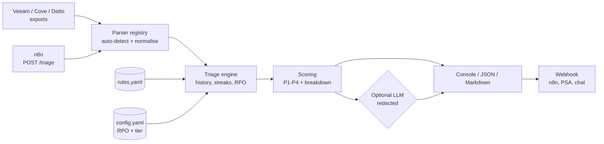

# RecoveryPilot

[](https://github.com/ich74851-doom/recoverypilot/actions/workflows/ci.yml)
[](pyproject.toml)
[](LICENSE)
[](https://github.com/astral-sh/ruff)

**AI-assisted backup incident triage for MSP backup operations.** RecoveryPilot reads backup
job exports from Veeam, Cove, Datto and other tools, classifies every failure with a
deterministic rules engine, scores it against each client's RPO and tier, and hands the
technician a prioritised P1-P4 queue with evidence and remediation steps. An optional LLM
layer writes the shift-handover summary, with client names redacted before anything leaves
the machine.

> Status: v0.1.0, early but working. All sample data in this repository is synthetic.

## The problem

Every morning an MSP backup engineer opens several consoles (Veeam, Cove, Datto, a Microsoft
365 backup portal) and works through dozens of red and yellow jobs. The hard part is not
seeing the failures; it is deciding **which one matters first**:

- A VSS writer error on a tier-1 client's SQL server that has already failed two nights in a
  row and is 30 hours past its RPO is urgent. The same error on a standard workstation that
  backed up fine three hours ago can wait.
- A job that reports **success** while 63% of the file server changed and `.akira` files
  appeared is the most urgent item on the list, and no console will colour it red.
- The same handful of root causes (VSS, full repositories, expired credentials, timeouts,
  offline agents) repeat every week, yet the fix knowledge lives in people's heads.

RecoveryPilot turns that judgement into code: consistent classification, an explainable
score tied to RPO/SLA, and a runbook step for every finding, so first-line technicians triage
like senior engineers and nothing quietly slips past its RPO.

## Features

- **Multi-vendor ingestion** with auto-detection: Veeam-style job CSV, Cove-style device CSV,
  Datto BCDR-style agent JSON, plus a generic JSON/CSV format for anything else (for example
  an n8n transform of a Microsoft 365 backup report).
- **YAML rules engine** with 14 bundled rules: ransomware indicators (encryption extensions,
  ransom-note text, abnormal change rate), VSS, SQL/Exchange application-aware processing,
  storage and quota, credentials and expired tokens, recovery-point verification, network
  timeouts, offline agents, licensing, locked files, CBT resets and RPO staleness.
- **History-aware context**: failure streaks, time since the last usable restore point and
  RPO breach are derived across runs, and rules run on *successful* jobs too.
- **Explainable scoring**: severity + RPO breach + failure streak + client tier, itemised in
  every finding and mapped to P1-P4.
- **Per-client policy**: RPO hours and tier per client in one YAML file.
- **Optional AI summary** (off by default) through a provider interface: `mock` (offline),
  any OpenAI-compatible endpoint (OpenAI, Azure gateways, Ollama, vLLM) or Anthropic. Client
  and host names are pseudonymised before the call and restored afterwards. The model never
  changes a priority.
- **Outputs for people and machines**: console table, JSON (stable schema for automation),
  Markdown (ticket notes, Teams posts), and `--fail-on P1` exit codes for RMM monitors.
- **n8n-ready**: push the report to a webhook, or run `recoverypilot serve` and POST exports
  to `/triage`.
- **Lean and tested**: only `pydantic` and `PyYAML` at runtime, type hints and docstrings
  throughout, 69 pytest tests, ruff, CI on Python 3.11-3.13.

## Architecture



The deterministic engine decides; the AI only explains. Details, including the scoring
model and design decisions, are in [docs/architecture.md](docs/architecture.md).

## Quickstart

Requires Python 3.11 or newer.

```bash
git clone https://github.com/ich74851-doom/recoverypilot.git
cd recoverypilot
python -m venv .venv && source .venv/bin/activate   # Windows: .venv\Scripts\activate
pip install -e .

recoverypilot formats          # supported input formats
recoverypilot rules list       # bundled classification rules
```

Triage the synthetic samples (the `--as-of` flag pins "now" to the sample date so the RPO
maths is reproducible):

```bash
recoverypilot triage examples/*.csv examples/*.json \
  --config examples/config.example.yaml \
  --as-of 2026-10-20T08:00:00Z \
  --json-out reports/triage.json --md-out reports/triage.md
```

Real output:

```text
RecoveryPilot 0.1.0 - backup incident triage
As of 2026-10-20 08:00 UTC | sources: cove_devices.csv, veeam_jobs.csv, datto_agents.json, m365_generic.json
Jobs evaluated: 20 | healthy: 5 | findings: 15 | RPO breaches: 9
Priorities: P1=5  P2=5  P3=2  P4=3

PRI SCORE  RULE        CATEGORY     CLIENT / HOST                        SINCE OK
---------------------------------------------------------------------------------
P1     90  RANSOM-001  ransomware   Fabrikam Legal / FAB-FS01               2.3h
P1     90  RANSOM-002  ransomware   Tailspin Clinic / TSC-FS02                1h
P1     90  STOR-001    storage      Fabrikam Legal / FAB-APP01               55h!
P1     86  APP-001     application  Northwind Dental / NWD-SQL01           54.3h!
P1     85  RPO-001     rpo          Fabrikam Legal / FAB-LT02              86.7h!
P2     76  AUTH-001    credentials  Contoso Logistics / contoso-log...     53.5h!
P2     75  AUTH-001    credentials  Adatum Accounting / ADA-APP02         178.4h!
P2     65  STOR-001    storage      Adatum Accounting / ADA-FS01           54.8h!
P2     65  NET-001     network      Tailspin Clinic / TSC-PM01               75h!
P2     60  VERIFY-001  verification Contoso Logistics / CTL-SQL02             2h
P3     53  AGENT-001   agent        Adatum Accounting / ADA-LT07            134h!
P3     51  NET-001     network      Contoso Logistics / CTL-WEB01          29.3h!
P4     35  LICENSE-001 licensing    Adatum Accounting / ADA-SQL01            27h
P4     25  LOCK-001    file-access  Northwind Dental / NWD-WS03               4h
P4     20  CBT-001     cbt          Contoso Logistics / CTL-HV01            3.8h

! = RPO breached

Top incident: [P1] Known ransomware / encryption extensions in protected data
  Fabrikam Legal / FAB-FS01 (veeam, File Server Daily)
  Evidence: suspicious extensions observed: .akira; change rate 63% >= 40%
  First step: Do NOT delete or prune any restore points; pause retention/cleanup jobs for this client.
```

Every finding in the JSON report carries its evidence and score breakdown, for example:

```json
{
  "rule_id": "STOR-001",
  "priority": "P1",
  "score": 90,
  "score_breakdown": [
    { "factor": "severity", "points": 55, "detail": "high" },
    { "factor": "rpo_breach", "points": 20, "detail": "55.0h since success vs RPO 12h" },
    { "factor": "failure_streak", "points": 5, "detail": "2 consecutive failures" },
    { "factor": "client_tier", "points": 10, "detail": "tier 1" }
  ],
  "evidence": [
    "status=failed",
    "message matches /not enough (free )?(disk )?space/",
    "RPO 12h breached (55.0h since last success)"
  ]
}
```

See the full Markdown output, including remediation steps and the mock AI summary, in
[docs/sample-report.md](docs/sample-report.md).

### More commands

```bash
# Add the AI summary with the offline mock provider (no key needed)
recoverypilot triage examples/datto_agents.json --as-of 2026-10-20T08:00:00Z --llm

# Use a real model (key read from the environment, names redacted by default)
export RECOVERYPILOT_LLM_API_KEY=...
recoverypilot triage exports/*.csv -c config.local.yaml --llm --llm-provider anthropic

# RMM / scheduled-task check: exit code 2 if anything is P1
recoverypilot triage exports/veeam.csv --fail-on P1

# Export the bundled rules as a starting point for your own
recoverypilot rules export > my_rules.yaml
recoverypilot triage exports/*.csv --rules my_rules.yaml
```

## Configuration

All settings are optional. Copy [`examples/config.example.yaml`](examples/config.example.yaml)
to `config.local.yaml` (git-ignored) and pass it with `--config`.

```yaml
default_rpo_hours: 24
default_tier: 3              # 1 = business critical, 3 = standard
clients:
  Northwind Dental:  { rpo_hours: 24, tier: 1 }
  Fabrikam Legal:    { rpo_hours: 12, tier: 1 }
priority_thresholds: { p1: 80, p2: 60, p3: 40 }
# rules_file: ./my_rules.yaml
# webhook_url: https://n8n.example.com/webhook/backup-triage
llm:
  enabled: false
  provider: mock             # mock | openai | anthropic
  model: gpt-4o-mini
  # base_url: http://localhost:11434/v1   # any OpenAI-compatible endpoint
  api_key_env: RECOVERYPILOT_LLM_API_KEY
  max_findings: 15
  redact: true
```

**Rules** live in YAML. A rule matches when all of its conditions hold; inside a list, any
item may match:

```yaml
- id: VSS-001
  title: VSS snapshot / writer failure
  category: vss
  severity: high
  priority: 20
  match:
    statuses: [failed, warning]
    message_regex: ['\bVSS\b', 'shadow copy', 'VSS_E_[A-Z_]+', '0x800423f[0-9a-f]']
  remediation:
    - Run `vssadmin list writers` and note any writer not in a Stable / No error state.
    - Restart the service that owns the failed writer out of hours.
```

Available conditions: `statuses`, `vendors`, `message_regex`, `extensions_any`,
`min_change_rate_pct`, `min_files_changed`, `min_consecutive_failures`, `rpo_breached`.

| Environment variable | Purpose |
| --- | --- |
| `RECOVERYPILOT_LLM_API_KEY` | API key for the LLM provider (name configurable via `llm.api_key_env`) |
| `RECOVERYPILOT_TOKEN` | Bearer token required by `recoverypilot serve` when set |

## n8n integration

RecoveryPilot is designed to slot into the same kind of n8n automation as my
[n8n-ai-ticket-analysis](https://github.com/ich74851-doom/n8n-ai-ticket-analysis) workflow,
which analyses Autotask tickets with Claude. Two patterns:

**1. n8n calls RecoveryPilot (pull).** Run the API on the automation host:

```bash
export RECOVERYPILOT_TOKEN=change-me
recoverypilot serve --host 127.0.0.1 --port 8080 --config config.local.yaml
```

In n8n, fetch or receive the backup export, then use an **HTTP Request** node:

- Method `POST`, URL `http://127.0.0.1:8080/triage`
- Header `Authorization: Bearer change-me`
- JSON body:

```json
{
  "content": {{ JSON.stringify($json.exportText) }},
  "format": "auto",
  "llm": false,
  "include_markdown": true
}
```

The response is the JSON report (plus `markdown`). Typical next nodes: an **IF** on
`summary.by_priority.P1 > 0`, then create or update an Autotask ticket per P1 finding with the
Markdown as the ticket note, and post the summary to Teams or Slack.

Test it without n8n:

```bash
curl -s -X POST http://127.0.0.1:8080/triage \
  -H "Authorization: Bearer change-me" -H "Content-Type: application/json" \
  -d "$(python -c 'import json;print(json.dumps({"content":open("examples/cove_devices.csv").read(),"as_of":"2026-10-20T08:00:00Z"}))')"
```

**2. RecoveryPilot pushes to n8n.** Schedule the CLI (cron, Task Scheduler or an RMM
script) and send the report to an n8n **Webhook** node:

```bash
recoverypilot triage exports/*.csv -c config.local.yaml --post-to https://n8n.example.com/webhook/backup-triage
```

## Project layout

```text
src/recoverypilot/
  cli.py            # triage / rules / formats / serve
  engine.py         # grouping, history context, classification
  rules.py          # YAML rule models and matcher
  scoring.py        # explainable score and P1-P4 bands
  models.py         # pydantic models
  config.py         # settings and per-client policy
  report.py         # console, JSON, Markdown
  webhook.py        # outbound POST and HTTP API
  parsers/          # veeam, cove, datto, generic (+ registry)
  llm/              # provider interface, mock, OpenAI-compatible, Anthropic, redaction
  data/default_rules.yaml
examples/           # synthetic sample exports and config
docs/               # architecture and sample report
tests/              # pytest suite
```

## Roadmap

Planned work is tracked in [issues](https://github.com/ich74851-doom/recoverypilot/issues):

- [ ] Parsers for Acronis Cyber Protect and Microsoft 365 backup report exports
- [ ] Per-job change-rate baselines, so ransomware detection compares against each job's
      own normal instead of a fixed threshold
- [ ] Importable n8n workflow template (export in, Autotask ticket and Teams post out)
- [ ] Container image and `docker compose` example for the webhook API
- [ ] Self-contained HTML report alongside JSON and Markdown

## Related projects

- [n8n-ai-ticket-analysis](https://github.com/ich74851-doom/n8n-ai-ticket-analysis): n8n + Claude analysis of Autotask tickets
- [backup-sla-dashboard](https://github.com/ich74851-doom/backup-sla-dashboard): SLA and success-rate reporting from the same kind of exports (RecoveryPilot focuses on per-incident triage instead)
- [backup-dr-powershell-toolkit](https://github.com/ich74851-doom/backup-dr-powershell-toolkit): on-host VSS, repository and event-log checks
- [dr-runbooks](https://github.com/ich74851-doom/dr-runbooks): the ransomware and DR runbooks the remediation steps point to

## Contributing and security

See [CONTRIBUTING.md](CONTRIBUTING.md) and [SECURITY.md](SECURITY.md). Please never attach
real client exports to issues; reproduce with synthetic data.

## License

[MIT](LICENSE) © Ishant Choudhary
