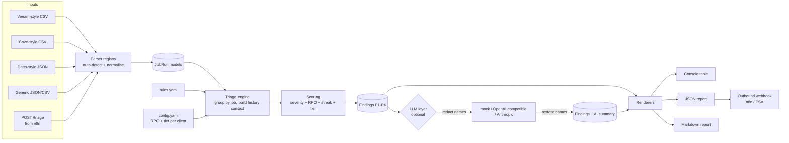

# Architecture

RecoveryPilot is a small pipeline with one rule: **the deterministic engine decides, the AI
explains.** Classification, severity and priority never depend on a language model, so the
same input always gives the same triage, works offline and can be reviewed line by line.

## Components

| Module | Responsibility |
| --- | --- |
| `models.py` | Pydantic models: `JobRun` (normalised input), `Finding`, `TriageReport`, enums for status, severity and priority. |
| `parsers/` | One module per vendor format. Each parser implements `sniff()` (0-100 confidence) and `parse()`. `@register` adds it to the registry; `detect_parser()` picks the most confident one. |
| `rules.py` + `data/default_rules.yaml` | Declarative rules. Conditions are AND-ed; list items are OR-ed. Regexes are compiled once at load and invalid rules fail fast with a clear validation error. |
| `engine.py` | Groups runs by `(client, job, host)`, sorts history, derives the failure streak, last restore point and RPO status, evaluates rules on the latest run and builds findings. |
| `scoring.py` | Turns a rule's base severity into a 0-100 score with an itemised breakdown, then into P1-P4. |
| `config.py` | Settings with safe defaults: default RPO, per-client RPO/tier, priority thresholds, LLM options. |
| `llm/` | Provider interface, `MockProvider`, `OpenAICompatibleProvider`, `AnthropicProvider` (stdlib HTTP, no SDKs), prompt building and reversible redaction. |
| `report.py` | Console, JSON and Markdown rendering. |
| `webhook.py` | `post_report()` for outbound delivery and a `ThreadingHTTPServer` API (`GET /health`, `POST /triage`). |
| `cli.py` | `triage`, `rules`, `formats` and `serve` sub-commands. |

## Triage algorithm

For every job identity `(client, job_name, host)`:

1. **Sort history** oldest to newest; the newest run is the one being triaged.
2. **Failure streak**: count trailing runs that are `failed` or `missed`.
3. **Last restore point**: newest run that is `success` or `warning` (a warning normally still
   produces a usable restore point), or a `last_success_at` value supplied by the export.
4. **RPO status**: breached when `as_of - last restore point > client RPO`. If no restore point
   is known the age is reported as unknown and **no breach is assumed**, because a single
   export rarely contains a job's whole history.
5. **Rules**: evaluate every rule. Matches are ordered specific-before-fallback, then by
   severity, then by rule priority. The first is the headline; the rest are recorded as
   `secondary_matches` and their remediation steps are appended (deduplicated).
6. **No match**: a healthy job is counted and skipped; a failed/warning/missed job with no
   matching rule becomes `GEN-000 Unclassified` so nothing is silently dropped.
7. **Score** and sort findings by score, then severity.

Note that rules run on *successful* jobs too. That is deliberate: a job that "succeeded" while
backing up 63% changed data with new `.akira` files is the most urgent item in the queue.

## Scoring model

| Factor | Points |
| --- | --- |
| Base severity | info 0, low 15, medium 35, high 55, critical 80 |
| RPO breached | 10, plus 5 per full RPO multiple overdue (max +10) |
| Failure streak | 5 per consecutive failure after the first (max 15) |
| Client tier | tier 1 +10, tier 2 +5, tier 3 +0 |

Default bands: P1 >= 80, P2 >= 60, P3 >= 40, otherwise P4 (configurable). A critical
ransomware indicator is therefore always P1, while a high-severity failure becomes P1 only
when context (RPO, streak, tier) makes it urgent. The weights are a starting point, not a
validated model; tune them in config for your own SLAs.

## AI layer

- Off by default; `--llm` or `llm.enabled: true` turns it on. `provider: mock` produces a
  deterministic summary with no network access, which is what CI and the demo use.
- Only the top `max_findings` findings are sent, as compact JSON.
- With `redact: true` (default) client and host names become `CLIENT-01`, `HOST-01`, ... and
  are mapped back locally after the reply.
- The model is asked for JSON (`summary` + per-finding `notes`). Replies wrapped in code
  fences are handled; anything unparseable is kept as plain summary text instead of failing
  the run.
- The model output is advisory text only and cannot change priority or classification.

## Extension points

- **New vendor**: add a parser module (see `CONTRIBUTING.md`) or transform the export into
  the generic format in n8n.
- **New failure pattern**: add a YAML rule; no code changes.
- **New provider**: subclass `LLMProvider` and implement `complete(system, user)`.
- **New output**: renderers are pure functions of `TriageReport`.

## Design decisions

- **Stdlib HTTP instead of vendor SDKs** keeps the dependency footprint to `pydantic` and
  `PyYAML`, which matters on locked-down management servers.
- **Latest run per job** rather than per run: technicians work on jobs, not on individual
  sessions, and history is folded into the streak and RPO context.
- **Explainability over cleverness**: every score has a breakdown and every classification
  lists the evidence that triggered it.
